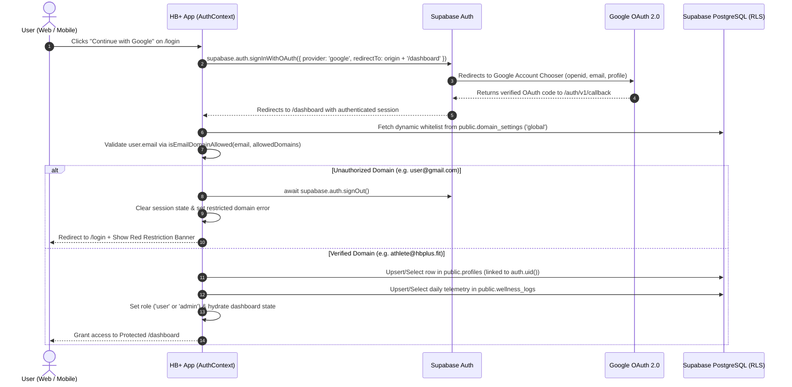
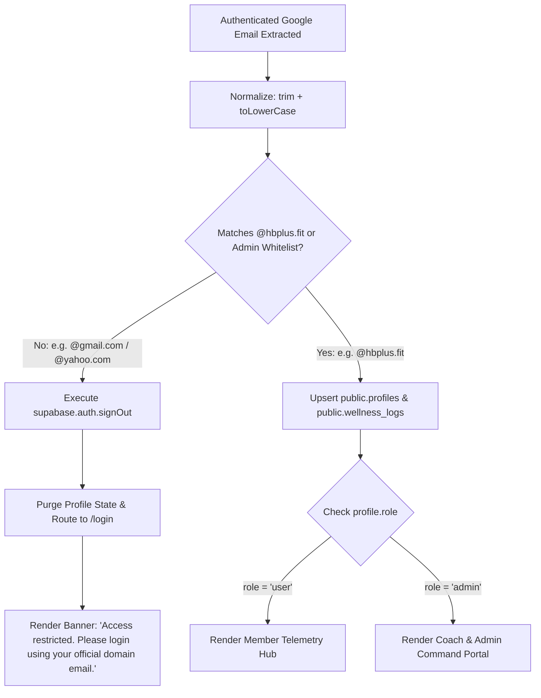

# HB+ (`hbplus.fit`) — Integrated Health, Fitness & Mental Wellness Portal

[](https://hbplus-wellness.netlify.app)
[](https://www.typescriptlang.org/)
[](https://react.dev/)
[](https://supabase.com/)
[](https://tailwindcss.com/)

A production-ready, cross-platform health, strength, precision nutrition, and autonomic mental wellness application engineered for **HB+ (`hbplus.fit`)**. Designed with a responsive dark performance aesthetic across Mobile (`360px–480px`), Tablet (`768px–1024px`), and Desktop (`1280px+`), backed by **Supabase Authentication (Google OAuth 2.0)**, strict **`@hbplus.fit` corporate domain enforcement**, and **PostgreSQL Row-Level Security (RLS)**.

- **Live Production App:** [https://hbplus-wellness.netlify.app](https://hbplus-wellness.netlify.app)
- **Auth & Recruiter Sandbox:** [https://hbplus-wellness.netlify.app/login](https://hbplus-wellness.netlify.app/login)

---

## Table of Contents

1. [Evaluation Guide](#1-evaluation-guide)
2. [Authentication Flow](#2-authentication-flow)
3. [How Domain Restriction Works (`@hbplus.fit`)](#3-how-domain-restriction-works-hbplusfit)
4. [Setup Instructions (Local Web, Mobile & Supabase)](#4-setup-instructions-local-web-mobile--supabase)
5. [Product Tour & Feature Architecture](#5-product-tour--feature-architecture)
6. [Database Schema & Row-Level Security (RLS)](#6-database-schema--row-level-security-rls)
7. [Project Structure](#7-project-structure)
8. [Deployment (Netlify)](#8-deployment-netlify)

---

## 1. Evaluation Guide

You can evaluate every authentication rule, role permission, and telemetry feature immediately at **[https://hbplus-wellness.netlify.app/login](https://hbplus-wellness.netlify.app/login)** in two ways:

### Option A: Live Google OAuth (`Continue with Google`)
- **Sign in with an `@hbplus.fit` Google account** (e.g., `name@hbplus.fit`): Passes domain verification, automatically creates/hydrates your `profiles` and `wellness_logs` rows in Supabase PostgreSQL, and routes you directly to `/dashboard`.
- **Sign in with a personal `@gmail.com` account**: Completes the Google OAuth handshake, detects the unauthorized domain, immediately executes `supabase.auth.signOut()`, keeps you on `/login`, and displays:
  > *"Access restricted. Please login using your official domain email."*

### Option B: Built-In Recruiter Testing Sandbox (No Corporate Credentials Needed)
Directly beneath the Google Sign-In button on `/login`, use the **Recruiter Testing Sandbox** to test all three states in one click:
1. **Login as Member (`member@hbplus.fit`)** — Opens the personal **Member Telemetry Hub** (Strength sets + 60s live rest timer, Macro Rings, 4-7-8 Breathwork orb, Steps & Hydration).
2. **Simulate Blocked User (`user@gmail.com`)** — Demonstrates the exact unauthorized domain rejection flow and error banner.
3. **Login as Coach / Admin (`admin@hbplus.fit`)** — Opens the **Coach & Admin Command Portal** (Athlete roster filtering, 10% HRV deload tool, weekly split editor, macro sliders, clinical coach notes, and dynamic domain whitelist management).

---

## 2. Authentication Flow

Authentication is powered by **Supabase Auth (`@supabase/supabase-js`)** using the **Google OAuth 2.0** provider, paired with a cross-platform session storage adapter (`localStorage` → `sessionStorage` → in-memory fallback) so OAuth PKCE code verifiers survive full-page redirects reliably on desktop and mobile browsers.

### End-to-End Sequence Diagram



### Step-by-Step Lifecycle
1. **Route Guard Initialization:** Unauthenticated requests to `/dashboard` are intercepted by `AuthContext` and `AppRouter` and redirected cleanly to `/login`.
2. **OAuth Initiation:** Clicking **Continue with Google** invokes `supabase.auth.signInWithOAuth({ provider: 'google' })` with dynamic origin detection (`window.location.origin + '/dashboard'`), supporting both `http://localhost:3000` and `https://hbplus-wellness.netlify.app`.
3. **Session Hydration:** On redirect return, `supabase.auth.getSession()` and `supabase.auth.onAuthStateChange` capture the `SIGNED_IN` event and pass the authenticated `SupabaseUser` object into `syncSupabaseUserSession()`.
4. **Domain Gate & Profile Provisioning:** Only after passing domain verification does the app upsert the user's record in `public.profiles` and initialize their daily `public.wellness_logs` row.
5. **Clean Sign-Out:** Clicking **Sign Out** in the dashboard header clears local and remote Supabase tokens (`supabase.auth.signOut()`) and returns the user to the public Landing Page (`/`).

---

## 3. How Domain Restriction Works (`@hbplus.fit`)

HB+ implements **multi-layered domain restriction** so unauthorized external accounts can neither enter the UI nor write records to the database.



### Layer 1: Configurable Environment Baseline (`src/config/supabase.ts`)
- The primary allowed domain is configured via `VITE_ALLOWED_DOMAIN` / `EXPO_PUBLIC_ALLOWED_DOMAIN` (defaulting to `hbplus.fit`).
- The validator normalizes email casing, strips accidental `@` prefixes or whitespace, and checks exact domain suffix boundaries (`normalizedEmail.endsWith('@' + domain)`), preventing spoofing attempts such as `hbplus.fit@evil.com` or `fakehbplus.fit`:

```ts
export function isEmailDomainAllowed(
  email: string | null | undefined,
  allowedDomains: string[]
): boolean {
  if (!email || !email.includes('@')) return false;
  const normalizedEmail = email.trim().toLowerCase();
  const normalizedDomains = allowedDomains
    .map((d) => d.trim().toLowerCase().replace(/^@/, ''))
    .filter((d) => d.length >= 3);

  return normalizedDomains.some((domain) => normalizedEmail.endsWith(`@${domain}`));
}
```

### Layer 2: Immediate Session Revocation (`src/context/AuthContext.tsx`)
- Before any `profiles` or `wellness_logs` query is executed, `syncSupabaseUserSession()` checks `isEmailDomainAllowed(email, effectiveDomains)`.
- **If Rejected:**
  1. Immediately calls `await supabase.auth.signOut()` to revoke the browser's OAuth session token.
  2. Resets `profile` to `null` so protected routes remain locked.
  3. Redirects to `/login` and renders a high-contrast alert banner displaying the exact required message:
     > **"Access restricted. Please login using your official domain email."** *(alongside the attempted email badge so the user knows which Google account was rejected).*

### Layer 3: Dynamic Admin Whitelist Governance (`domain_settings`)
- Verified Admins (`role = 'admin'`) can dynamically add or remove partner corporate domains (e.g., `corp.hbplus.fit`) inside the **Coach & Admin Portal → Domain Access Governance** panel without redeploying code.
- Note: The core `hbplus.fit` domain is protected as immutable in the UI so administrators cannot accidentally lock out the primary organization.

### Layer 4: PostgreSQL Row-Level Security (`supabase/schema.sql`)
- Every table (`profiles`, `wellness_logs`, `domain_settings`) has PostgreSQL **Row-Level Security (RLS)** enabled.
- Standard users cannot self-assign `role = 'admin'` on insert or mutate their `role` column on update, and can only `SELECT` / `UPDATE` rows where `auth.uid() = id` (or `auth.uid() = user_id`).

---

## 4. Setup Instructions (Local Web, Mobile & Supabase)

### Prerequisites
- **Node.js:** `v20.19+` or `v22+` (LTS recommended — verify with `node -v`)
- **npm:** `v10+` (`npm -v`)
- **Supabase Account:** Free tier project at [supabase.com](https://supabase.com)
- **Google Cloud Project:** OAuth 2.0 Web Client credentials at [console.cloud.google.com](https://console.cloud.google.com)

---

### Step 1: Clone the Repository & Install Dependencies

```bash
git clone https://github.com/csmishra952/hbplus-wellness-portal.git
cd hbplus-wellness-portal
npm install
```

---

### Step 2: Configure Environment Variables (`.env`)

Create a `.env` file in the project root by copying `.env.example`:

```bash
cp .env.example .env
```

Fill in your Supabase **Project URL** *(base URL without `/rest/v1`)* and **`anon` `public` key** from **Supabase Dashboard → Project Settings → Data API**:

```env
# Primary corporate domain restriction
VITE_ALLOWED_DOMAIN=hbplus.fit
EXPO_PUBLIC_ALLOWED_DOMAIN=hbplus.fit

# Local development URL
APP_URL=http://localhost:3000

# Supabase Project URL & Publishable Anon Key
VITE_SUPABASE_URL="https://YOUR_PROJECT_REF.supabase.co"
VITE_SUPABASE_ANON_KEY="YOUR_SUPABASE_ANON_PUBLIC_KEY"

EXPO_PUBLIC_SUPABASE_URL="https://YOUR_PROJECT_REF.supabase.co"
EXPO_PUBLIC_SUPABASE_ANON_KEY="YOUR_SUPABASE_ANON_PUBLIC_KEY"
```

---

### Step 3: Initialize Supabase PostgreSQL Schema & RLS

1. Open your **Supabase Dashboard → SQL Editor → + New query**.
2. Copy the entire contents of [`supabase/schema.sql`](./supabase/schema.sql) and paste it into the editor.
3. Click **Run**.
   - The script is **idempotent** (`create table if not exists` / `drop policy if exists`), so it can be safely re-run at any time.
   - Verify in **Table Editor** that `profiles`, `wellness_logs`, and `domain_settings` (pre-seeded with `['hbplus.fit']`) exist with RLS enabled.

---

### Step 4: Configure Google OAuth in Google Cloud & Supabase

1. **Supabase Google Provider:**
   - Go to **Supabase Dashboard → Authentication → Sign In / Providers → Google** and toggle **Enable Sign in with Google** to **ON**.
   - Copy the **Callback URL**: `https://YOUR_PROJECT_REF.supabase.co/auth/v1/callback`.
2. **Google Cloud Console (`Google Auth Platform`):**
   - Configure **Branding** (`External` audience, App Name, Support Email, Homepage URL, Privacy Policy URL) and set Publishing Status to **In production** under **Audience**.
   - Under **Clients**, create an **OAuth client ID (`Web application`)**:
     - **Authorized JavaScript origins:** `http://localhost:3000` (and your production domain, e.g., `https://hbplus-wellness.netlify.app`)
     - **Authorized redirect URIs:** `https://YOUR_PROJECT_REF.supabase.co/auth/v1/callback`
   - Paste the resulting **Client ID** and **Client Secret** back into Supabase's Google provider settings and click **Save**.
3. **Supabase Redirect URLs:**
   - Under **Supabase → Authentication → URL Configuration**, add:
     - `http://localhost:3000/**`
     - `https://hbplus-wellness.netlify.app/**`

---

### Step 5: Run Locally on Web & Mobile

```bash
npm run dev
```

- **Desktop Browser:** Open `http://localhost:3000`.
- **Mobile Responsive Viewports:** Open Chrome DevTools (`F12` → `Ctrl + Shift + M`) to inspect `360px` Mobile, `768px` Tablet, and `1440px` Desktop layouts.
- **Physical Smartphone Testing (iOS Safari / Android Chrome):** Connect your phone to the same Wi-Fi network as your computer and open the **`Network: http://192.168.x.x:3000`** address printed by Vite in the terminal (`--host=0.0.0.0` is enabled out of the box).

---

## 5. Product Tour & Feature Architecture

| Route / Surface | Key Capabilities |
| :--- | :--- |
| **`/` — Public Ecosystem Landing Page** | Sticky glass navbar + mobile full-screen drawer, fluid hero typography, interactive **Body Intelligence & Longevity SVG Map** (`Mind & ANS`, `Metabolic & Gut`, `Musculoskeletal` hotspots), 4-Pillar methodology cards, Coach roster, Hop Studio spotlight, and 1:1 Consultation modal. |
| **`/login` — Split-Screen Auth & Sandbox** | Official Google OAuth 2.0 sign-in, strict `@hbplus.fit` domain gate, contextual rejection alerts, and collapsible **Recruiter Testing Sandbox**. |
| **`/dashboard` — Member Telemetry Hub** | **Top Biometric Strip** (Recovery Ring, Sleep Architecture, 4-Pillar Alignment, 7-Day Adherence Heatmap) + **4 Interactive Pillar Cards**: Strength Split Tracker with **60s live rest timer** & tonnage calculator, Concentric SVG **Macro Rings** + quick meal logger, **4-7-8 Guided Breathwork Orb**, and **Steps + 8-Glass Hydration** tracker. |
| **`/dashboard` — Coach & Admin Command Portal** | Role-gated (`role = 'admin'`) workspace featuring Coach KPI strip, searchable/filterable Athlete Roster (`Needs Attention < 60%`), **Athlete Deep-Dive Client File** (1-click 10% HRV volume deload, exercise swapper, macro protocol sliders, timestamped clinical notes), and **Domain Whitelist Governance**. |
| **`/privacy` — Privacy & Data Disclosure** | Public OAuth compliance disclosure detailing identity scopes (`openid`, `email`, `profile`), domain filtering, and PostgreSQL RLS isolation. |

---

## 6. Database Schema & Row-Level Security (RLS)

Defined in [`supabase/schema.sql`](./supabase/schema.sql):

- **`public.profiles`** — Keyed by `id uuid references auth.users(id) on delete cascade`. Stores `email`, `full_name`, `avatar_url`, `role` (`'user' | 'admin'`), `assigned_program`, and `domain_verified`.
  - *RLS:* Users can read/update only their own profile (with `role` locked against self-escalation); Admins (`public.is_hbplus_admin()`) can view all profiles and assign training programs.
- **`public.wellness_logs`** — 1:1 daily telemetry table keyed by `user_id` storing `workout_completed`, `completed_exercises_count`, `workout_streak`, `calories_consumed`, `protein_grams`, `carbs_grams`, `fats_grams`, `water_glasses`, `steps_count`, `mindfulness_streak`, and `breathwork_sessions`.
  - *RLS:* Strict owner read/write (`auth.uid() = user_id`) plus read visibility for verified coaches/admins.
- **`public.domain_settings`** — Stores the organization's `allowed_domains text[]` whitelist (`id = 'global'`).
  - *RLS:* Readable by authenticated sessions for login validation; `INSERT` / `UPDATE` / `DELETE` restricted exclusively to `public.is_hbplus_admin()`.

---

## 7. Project Structure

```text
hbplus-wellness-portal/
├── public/
│   └── privacy.html               # Static OAuth privacy disclosure page
├── src/
│   ├── assets/images/             # High-resolution bundled athletic, studio & avatar assets
│   ├── components/
│   │   ├── BreathworkWidget.tsx   # Kinetic 4-7-8 autonomic breathing orb
│   │   ├── Header.tsx             # Responsive workspace header & role switcher
│   │   ├── NutritionPillarCard.tsx# Caloric gauge, 3 SVG Macro Rings & meal presets
│   │   ├── StrengthPillarCard.tsx # Per-set tracker, load steppers & 60s rest timer
│   │   └── VitalsPillarCard.tsx   # Step progress & interactive 8-glass hydration grid
│   ├── config/
│   │   └── supabase.ts            # Supabase client, URL sanitizer & domain validator
│   ├── constants/
│   │   ├── assets.ts              # Production-safe static Vite image manifest
│   │   └── theme.ts               # HB+ design tokens & training program templates
│   ├── context/
│   │   └── AuthContext.tsx        # OAuth lifecycle, @hbplus.fit gate, RBAC & DB sync
│   ├── screens/
│   │   ├── AdminScreen.tsx        # Coach & Admin Command Portal + Athlete Deep-Dive
│   │   ├── DashboardScreen.tsx    # Member Telemetry Hub
│   │   ├── LandingPage.tsx        # Public HB+ Ecosystem & Body Intelligence Map
│   │   ├── LoginScreen.tsx        # Google OAuth & Recruiter Testing Sandbox
│   │   └── PrivacyScreen.tsx      # In-app Privacy Policy route (/privacy)
│   ├── App.tsx                    # Route guard & navigation shell (/, /login, /dashboard, /privacy)
│   ├── index.css                  # Tailwind CSS v4 tokens, safe-area & scroll utilities
│   └── main.tsx                   # React 19 root mount
├── supabase/
│   └── schema.sql                 # Idempotent PostgreSQL tables, helper function & RLS
├── .env.example                   # Environment template (safe for version control)
├── index.html                     # Entry HTML with Outfit, Plus Jakarta Sans & JetBrains Mono
├── netlify.toml                   # Netlify Node 22 build config & SPA redirect rules
├── package.json                   # Project scripts & dependencies
├── tsconfig.json                  # TypeScript strict bundler configuration
└── vite.config.ts                 # Vite + Tailwind v4 configuration
```

---

## 8. Deployment (Netlify)

Production builds are pre-configured via [`netlify.toml`](./netlify.toml):

```toml
[build]
  command = "npm run build"
  publish = "dist"

[build.environment]
  NODE_VERSION = "22"

[[redirects]]
  from = "/*"
  to = "/index.html"
  status = 200
```

1. Run `npm run lint && npm run build` locally to verify zero TypeScript or bundler errors.
2. Connect the GitHub repository to **Netlify**.
3. Configure `VITE_ALLOWED_DOMAIN=hbplus.fit`, `EXPO_PUBLIC_ALLOWED_DOMAIN=hbplus.fit`, `VITE_SUPABASE_URL`, and `VITE_SUPABASE_ANON_KEY` in **Netlify → Environment variables**.
4. Whitelist the deployed `.netlify.app` domain in **Supabase → Authentication → URL Configuration** and **Google Cloud Console → Authorized JavaScript origins**.
